# MED5202-Tut
## Bioinformatics for MED5202 - RNAseq analysis

## Introduction

RNA-seq data analysis consists of three steps:
1.	Creating a read count table – quality trimming reads, aligning them to a genome and counting reads mapping to each gene, transcript or exon.
2.	Performing statistical analysis of the read count data to identify differentially expressed features and then reporting the results as text and graphics.
3.	Interpreting the results to determine what work needs doing to validate them and create new hypotheses to test.  

Today you'll be doing a simplified version of step 2 using R with some data from an experiment that looked at the effect of suppressing the expression of CDK4 using an siRNA. This gene is involved in controlling cellular division, so is important in cancer. The tutorial will consist of 3 steps:  

    1. Setting up R and RStudio on your computer and installing the packages needed to do the analysis.  
    2. Doing the analysis.  
    3. Saving the results as text and graphics files.  

## 1. Setting up R and RStudio

Setting up R and RStudio should be easy, how they are downloaded and installed depends on whether it's your PC or a University cluster computers, but before setting up R and RStudio, you need to make a folder to do the analysis in.

### 1.1 Making the required folders
Go to your ‘Documents’ folder and create a new folder called something like ‘MyWorkArea’ - it's best to use a descriptive name with no spaces in it. This folder is where all the files are saved too. Once you have created the folder, create a 2nd folder in it called ‘R’ (Figure 1.1). 

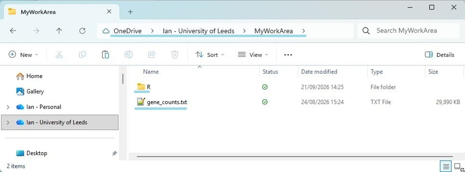

Figure 1.1

---

Next, download the ‘gene_counts.txt’ file from this GitHub’s Data folder and put it in the  ‘MyWorkArea’ folder. 

- Look at the top of this webpage to find the 'Data' folder (blur box in Figure 1.2).

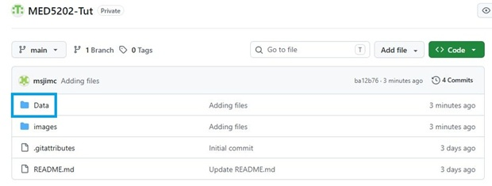

Figure 1.2

---

- Click on the 'gene_counts.txt' text (blue box in Figure 1.3).

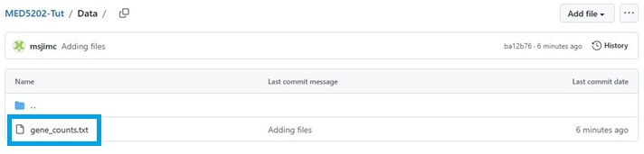

Figure 1.3

---

- You then download the file by clicking on the 'Download' icon in the upper-right of the webpage (blue box in Figure 1.4).

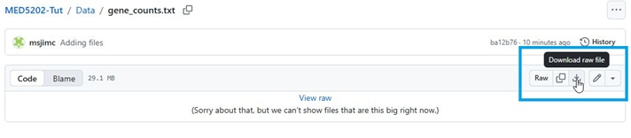

Figure 1.4

---

### 1.2 Installing R and RStudio
How you install R and RStudio depends on whether the computer is yours and you have admin permissions or whether it is a university cluster computer that uses AppsAnywhere.

#### UoL PC and AppsAnywhere

Go to the University of Leeds’ AppsAnywhere website: https://appsanywhere.leeds.ac.uk/login. Log on and then select the "__R for windows 4.6.1__" and "__RStudio__". Then use the AppsAnywhere program on the cluster PC to start and run R and RStudio (start R first).

#### Personal PC with admin rights

If you are using your own laptop, this is just a matter of downloading and installing R and RStudio.

___Note: It's best to install R first, followed by RStudio.___

- Downloading R  
R is hosted by the CRAN project at this URL: [https://cran.r-project.org/](https://cran.r-project.org/).Go to the website and download the correct R program for your operating system.  
- Downloading R Studio    
RStudio is a program that provides a rich user interface for working with R and comes as either a desktop program or a webserver. You want the desktop version which, can be downloaded from: https://docs.posit.co/ide/user/#rstudio-ide-oss-downloads. Download and install as you would any program.

### 1.3 The RStudio user interface

When RStudio starts, it displays a single window containing three panels (Figure 1.5). The large panel on the left (blue rectangle in Figure 1.5) is where you issue commands. The smaller panel on the upper right (red rectangle in Figure 1.5)  is where RStudio lists all the items it is working with. Finally, the  smaller lower right-hand panel lists various things, such as installed packages.

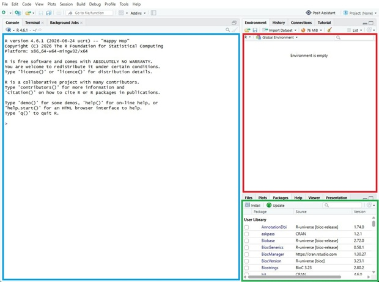

Figure 1.5: The blue, black and red rectangles identify each panel;  
- Blue rectangle – this is where each command is entered
- Red rectangle - this panel displays a list of all variables R is using.
- Green rectangle - this is the panel that shows a list of all the programs/packages that R is currently using.

---

___For this tutorial you'll type text into the left-hand panel___

### 1.4 An important point on file paths

When you refer to a file or folder in text, R expects the names of folders and files to be separated by a slash character. On Macs and Linux PCs the slash is a forward slash - "/", while on Windows PCs its a back slash - "\\". In programming, the back slash has other uses and for R, it must be changed to a forward slash or two back slashes:
- __“D:\\aFolder\\aSubfolder\R”__ -> __“D:/aFolder/aSubfolder/R”__
- __“D:\\aFolder\aSubfolder\R”__ -> __“D:\\\\aFolder\\\\aSubfolder\\\\R”__

## 2. Downloading R packages

There are a number of websites that distribute R packages, in this tutorial you will use Bioconductor, which is like an app store for bioinformatics R packages. To install packages from Bioconductor, you need to install BiocManager with the following commands:   

> if (!requireNamespace("BiocManager", quietly = TRUE)) {    
    install.packages("BiocManager")    
}    
library(BiocManager)

The statement after the ‘if’ checks whether BiocManager is already in the library folder. If it is, R does nothing. If it isn’t, R downloads all the required code and makes the package in your library folder. BiocManager is loaded for you to use with the library(BiocManager) command.  

Next you need to get the DESeq2 program using this set of commands:    

> if (!requireNamespace("DESeq2", quietly = TRUE)) {  
    BiocManager::install(c("DESeq2", "GenomicRanges"))  
}  
library(DESeq2)  

As before, the statement after the ‘if’ checks if DESeq2 is already in the library folder. If it isn’t it the commands in the curly brackets runs, downloading and building DESeq2 in your R library folder. This step may take a while to run. 

If you look in the ‘Packages’ tab of the lower left-hand panel (Figure 2.1), you should see DESeq2 along with it dependencies like GenomicRanges appear.
To allow R to use DESeq2, you have to load it using the _library(DESeq2)_ command. 

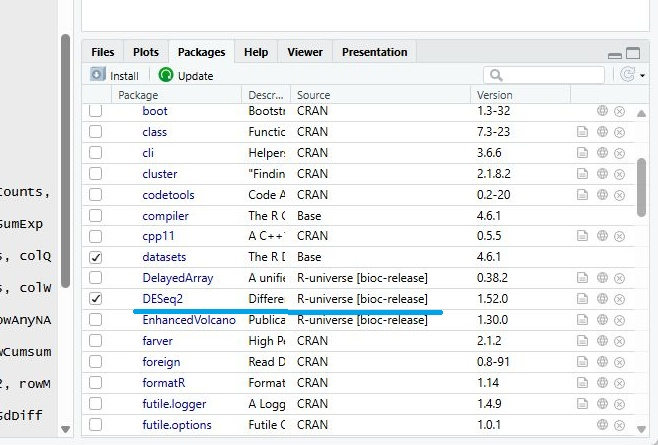

Figure 2.1 List of installed R packages. The tick indicates the package is loaded, ready to use.

---

## 3. Working Folder Setup
You now need to tell R where to find any data files and where to write any results files. This folder is called the __“Working Folder”__. Rather than repeatedly typing the location of this folder, you will save it as the _workFolder_ variable. To declare this variable with the location of your working folder, use this command:  
> workFolder <- "your/MyWorkArea"  

where you substitute "your/MyWorkArea" with the location of the working folder you made earlier, such as:    

> workFolder <- "D:/OneDrive - University of Leeds/MyWorkArea"  

___Remember___ The point in section 1.4 about the slash character in a folders path - When entering a file or folder's path use either a forward slash (__'/'__) or two back slashes (__'\\\\'__), not the single one suggested by a Windows PC.

Once you have created this variable, typing its name and pressing ‘Enter’ instructs R to write the variables contents on the next line:  
> workFolder  
[1] "D:  /OneDrive - University of Leeds/MyWorkArea"  

The variable's ane and contents will also appear in the upper left-hand panel (Figure 3.1).

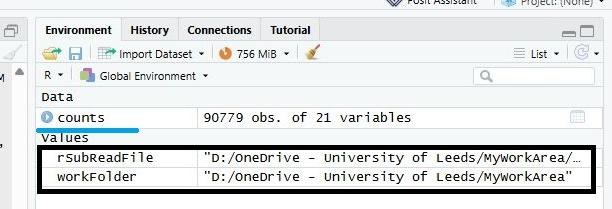

Figure 3.1: The _workFolder_ variable is displayed in the upper left-hand panel (black box).

To set this location as the working environment, it’s a good idea to check that the folder exists, and if not, make it. This is done with this command:  

> dir.create(workFolder, recursive = TRUE, showWarnings = FALSE)  

Once the folder has been created, it is set as the working folder with:  

>setwd(workFolder)  

Now all the files will be created in this folder, unless if a specific location is set when creating it. 

Finally, you need to reference the file that contains the read count data. This location is stored in the rSubReadFile variable with:  

> rSubReadFile <- file.path(workFolder, "__gene_counts.txt__")

Since the ‘__gene__counts_.txt__’ file is in the working folder, you can use’ the file.path’ function to combine the two pieces of text.

## 4. Loading and Preparing the Count Data
So far you have just set up the R environment, now you will actually do something, namely read the contents of the __gene__counts_.txt__ file into memory. This is done with:  

> _counts_ <- read.delim(rSubReadFile)  

Reading the data will take a moment and result in the creation of a new variable – ‘_counts_’. This variable isn’t like the ones you have made so far, its data is stored as if it were an Excel spreadsheet – it has rows and columns. This type of variable is called a “Data Frame” and consequently, it is listed in a different part of the upper-hand panel (Figure 4.4). 

Figure 4.1: Variables holding complex data are listed in the __Data__ area (blue line), while simple variables are listed in the __Values__ area (black box).

Double-clicking on it will cause the left-hand panel to split in two, with the upper part showing the variable’s contents (Figure 4.2). 

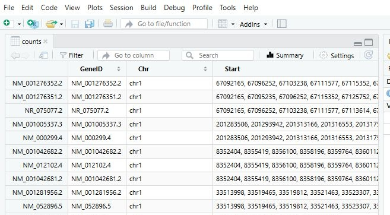

Figure 4.2: Double-clicking on a complex variable will open it in the upper half of the left-hand panel.

---

If you look at it, you’ll see that it contains a lot of data that you don’t need, such as the genomic coordinates of each transcript’s exons, as well as data for samples you will not use. The data columns you need are 16, 17, 18, 19, 20 and 20. However, if you visualize the variable by double clicking it in the upper left-hand panel and count the columns, it may appear the numbers are out by 1. This because the first column in the view is the name name used by R to reference each row and is not a data column. The filtering is done with this command: 

> columnsFromDataFile <- c(16, 17, 18, 19, 20, 21)

This command makes a special variable called either a vector. In this case the variable points to 6 different numbers. If you type the variable’s name and press ‘enter’, you get:  

> columnsFromDataFile   
[1] 16 17 18 19 20 21  

If you want to reference the third value (remember to count from 0), you type:  

> columnsFromDataFile[1]  
[1] 16

__Notice:__ you type the variable’s name and then the ‘index’ you want inside square brackets.  
Unfortunately, DESeq2 wants the data as a matrix and not a data frame. A matrix is similar to a data frame, but is doesn't come with a lot of helpful features as a data frame. To convert _counts_ to a matrix you filter use this command:  

> _counts_ <- as.matrix(_counts_[, columnsFromDataFile])  

This overwrites the original _counts_ variable with a new matrix variable that only contains the columns you want. However, it keeps the names of the rows and columns that the old matrix used (the first cell of each row for row names and the first line for column names). Double-click on the _counts_ variable in the upper right-hand panel and see its current state (Figure 4.3).

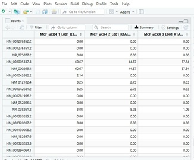]

Figure 4.3: The _counts_ variable now holds only the data you want.

---

Since the _counts_ data came from a text file, it’s best to explicitly tell R that the values are numbers. This is done with:   

> storage.mode(_counts_) <- "integer"  

Once this command has been completed, the _counts_ variable will no longer contain decimal numbers (Figure 4.4).

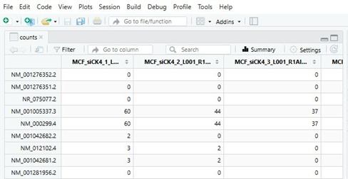]

Figure 4.4: The _counts_ variable now holds only whole numbers.

---

When analysing read count data, many sequences have very few read reads as they are not expressed. While it is possible to process these sequences, their result is very unlikely to be statistically significant and so you exclude them with:   

> counts <- counts[rowSums(counts > 3) > 2, ]  

The "rowSums(counts > 3)" determines which samples have more than 3 reads mapping to a sequence. If more than 2 do "(rowSums(counts_> 3) > 2)" directs R to keep that sequence’s data, if not that sequence’s data is removed from the dataset. Before running the command, the _counts_ matrix had 544,674 data points (see the text after the _counts_ variables name in the upper righthand panel), after the command it has 208,650.

## 5. Experimental Design Setup
So far you have loaded and organised the data in your PC’s memory. Now you need to describe the data so DESeq2 knows how to analyse it. This is done by creating a series of variables and then combining them to form a "sample table". The first thing to do is state what type of sample each column in _counts_ represents (control data or siCK4 knockdown data). This is done by making this vector:  

> groupsForEachSample <- c("siCK", "siCK", "siCK", "Control", "Control", "Control")  

This command creates a vector (groupsForEachSample) with 6 data points that describe the type of data in the _counts_ matrix. The first value (“siCK4”) describes the first column in the _counts_ matrix and the last column in _counts_ is described by the last value in the groupsForEachSample variable. Next you need a vector that holds the names of the columns:  

> sampleNames <- c("siCK4_1", "siCK4_2", "siCK4_3", "siNT3_1", "siNT3_2", "siNT3_3")  

As with the groupsForEachSample variable, the first value is for the first column and the last for the last column.

DESeq2 also needs to know what sample types are present and which is the reference. This done with this vector:  

> conditionLevels <- c("Control", "siCK")  

Because “Control” is mentioned first, that sample is the reference. Also note that these names are the same as in the groupsForEachSample variable.  
Rather than give each of these vector variables to DESeq2 one at a time, they are used to make a data frame with:  

> sampleTable <- data.frame(sample = sampleNames, condition = groupsForEachSample)

The sampleTable will contain the data shown in Table 1.

|sample|condition|
|-|-|
|siCK4_1|siCK|
|siCK4_2|siCK|
|siCK4_3|siCK|
|siNT3_1|Control|
|siNT3_2|Control|
|siNT3_3|Control|

Table 1.

The following commands, rename the columns in the _counts_ matrix (first command) and the second command will give the rows in the sampleTable row names (Table 2).  

> colnames(_counts_) <- sampleTable$sample  
> rownames(sampleTable) <- sampleTable$sample  

|(row names)|sample|condition|
|-|-|-|
|siCK4_1|siCK4_1|siCK|
|siCK4_2|siCK4_2|siCK|
|siCK4_3|siCK4_3|siCK|
|siNT3_1|siNT3_1|Control|
|siNT3_2|siNT3_2|Control|
|siNT3_3|siNT3_3|Control|

Table 2

## 6. DESeq2 Differential Expression Analysis
You are now at the point of doing the analysis which is started with the command: 

> dds <- DESeqDataSetFromMatrix(countData = _counts_, colData = sampleTable, design = ~ condition)  

This command sets up the DESeq2 analysis by creating the dds large dataset (Figure 5.1 - see upper right panel).  

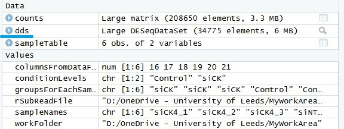

Figure 6.1: The creation of the DESeq2 data object (blue line).

---

You will also get a warning because the items in the conditionlevel vector have been put in alphabetical order, which may be different from what you want. This is corrected with:  

> dds$condition <- factor(dds$condition, levels = conditionLevels)  

You now need to set the sequences’ names in the dds dataset to their GenBank accession IDs which are used in the _counts_ matrix. This is done with:  

> mcols(dds)$gene <- rownames(_counts_)  

The _rownames(counts)_ gets all the names of the rows in the _counts_ object and gives them to a new column called ‘gene’ on the dds dataset.  
Finally, the analysis is performed with this command:  

> dds <- DESeq(dds)  

As DESeq2 runs, updates its progress with:  

> estimating size factors  
estimating dispersions  
gene-wise dispersion estimates  
mean-dispersion relationship  
final dispersion estimates  
fitting model and testing  

The basic analysis is now complete, and you just need to save the relevant data to file. The results of the analysis are extracted from the dds dataset to make the res dataset with:  

> res <- results(dds)  

While a summary of the analysis is produced with:  

> summary(res)  

The summary for this analysis is:  

> out of 34775 with nonzero total read count  
adjusted p-value < 0.1  
LFC > 0 (up)       :   2399, 6.9%  
LFC < 0 (down)     :   1188, 3.4%  
outliers [1]       :   3, 0.0086%  
low _counts_ [2]     :   9436, 27%  
(mean count < 9)  

This data can then be saved as an Excel spreadsheet *.CSV file with:  

> write.csv(as.data.frame(res), file = "standard_analysis_Deseq2.csv") 

The sequences with a p-value adjusted for multiple testing of less than 0.05 can be extracted and saved to a CSV file with:  

> resSig <- subset(res, padj < 0.05)  
write.csv(as.data.frame(resSig), file = "standard_analysis_Deseq2_significant_05.csv")

## 7. Volcano Plot Visualisation
While you have now completed the differential expression analysis, it is standard practice to produce some pictures that summarise the results. One type of graphic is the volcano plot, which graphs the sequences’ p-value against their change in expression. A widely used package for drawing volcano plots in R is the EnhancedVolcano package. This is downloaded from Bioconductor in the same way you got the DESeq2 package:  

>if (!requireNamespace("EnhancedVolcano", quietly = TRUE)) {  
    BiocManager::install("EnhancedVolcano")  
}  
library(EnhancedVolcano)  

So far you have produced data that can be saved as text, but creating pictures has to be done in a different way. In R pictures are drawn on a ‘device’, which is something that can store a picture's data. Since you are saving the picture to file, you’ll make a new device for each image. A typical image file format is the PNG, so you make and open a PNG file with:  

> png("VolcanoPlot.png")  

This opens a PNG file called VolcanoPlot.png (but doesn't save it to disk). Next, you draw the image with:  

> EnhancedVolcano(  
    res,  
    lab = rownames(res),  
    title = "siCK4 v control",  
    subtitle = "DESeq2 Differential Expression",  
    caption = bquote(\~Log[2]\~ "fold change cutoff:   2,  
    padj cutoff:   0.05"),  
    pCutoff = 0.05,  
    FCcutoff = 1,  
    x = "log2FoldChange",  
    y = "padj"  
)

While this is written across multiple lines, R reads all the text between the two brackets as one line/command. The basic structure of this command that the word   EnhancedVolcano tells R what function to use and the text in the brackets lists the data to be used by the EnhancedVolcano function. Table 3 describes each parameter:  

|Parameter|Description|
|-|-| 
|res,|The DESeq2 results dataset you made in the last section.|
|lab|The label for each data point.|
|title|Main title displayed at the top of the volcano plot.|
|subtitle|A smaller subtitle placed under the main title.|
|caption|Text displayed at the bottom of the plot|
|pCutoff|Set the p-value cutoff, values drawn either side of this have |different colours.|
|FCcutoff|Fold change threshold, values drawn either side of this have different colours.|
|x|Data column to use as X the graphs value|
|y|Data column to use as Y the graphs value|
 
Table 3

When the graph has been drawn, it is saved by closing the file with:    
> dev.off()  

A file called VolcanoPlot.png should now appear in your working folder (Figure 6.1).

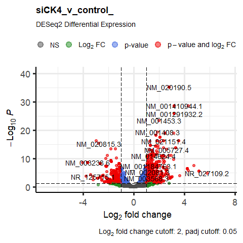

Figure 6.1: The volcano plot

---

## 8. Heatmap of Significantly Altered Transcripts
Another type of graphic used to summarise a differential expression analysis is the heatmap. They create an image which contains a column for each sample and draws each transcript down each column. In the heatmap you’ll draw, the samples and transcripts are clustered, so similar samples are drawn close to each other and very similar transcripts are drawn next to each other.  
Before you can draw the heatmap, you have to prepare the data. The expression dataset is made of thousands of transcripts and trying to draw all of them may require more memory than your PC has. Consequently, people only use the sequences that are significantly different. This is done with:  

> select <- which(res$padj < 0.01)  
df <- as.data.frame(colData(dds)[, c("condition", "sample")])  

The select variable contains a vector of all the row indexes that are significant. The df variable is a dataframe (Table) that contains the same data as the sampletable you made earlier (Table 2).  

Currently, all the read count data is the absolute value, so it is bigger in samples that had more reads in the raw sequencing data. Also, data for poorly expressed sequences is noisier than for highly expressed sequences. Consequently, the data needs to be normalised for the size of each sample’s read data and the effects of noise on poorly expressed sequences. This is done with:  

> nt <- normTransform(dds)  
normcounts <- assay(nt)[select, ]  

The nt variable contains the normalised data of all sequence, which is then filtered in the second command to create the normcounts variable.

Now you have the data, you can download the pheatmap package which will draw the heatmap.  

>if (!requireNamespace("pheatmap", quietly = TRUE)) {  
    install.packages("pheatmap")  
}  
library(pheatmap)  

As with the volcano plot, you draw the graph to a PNG file with:  

> png("Heatmap.png")  

Then you draw the graph with:   

> pheatmap(  
        normcounts,  
        cluster_rows = TRUE,  
        show_rownames = FALSE,  
        cluster_cols = TRUE,  
        annotation_col = df,  
        scale = "row",  
        main = "Differential expressed sequences"  
    )  

As with the volcano plot function, R reads this as one command with the parameters described in Table 4.

|Parameter|Description|
|-|-|
|normcounts|The normalised read count dataset|
|cluster_rows|Determines is the sequences are clustered or drawn in the order they appear in the dataset.|
|show_rownames|Sets whether the sequences names are written on the heatmap.|
|cluster_cols|Determines is the samples are clustered or drawn in the order they appear in the dataset.|
|annotation_col|Provides the names and type (Control or siCK4)of the sample in each column.|
scale|Determines how the sequences are colour coded. ‘row’ directs the colours to be scaled by the expression of the sequence across the samples.|
|main|The heatmaps title|

Table 4	

When the heapmap has been drawn, it is saved to a file with:  

> dev.off()  

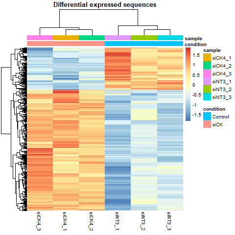

Figure 8.1: The Heatmap.

---

## 9. Principal Component Analysis (PCA) Visualisation

PCA plots are graphs that condense the differences between a set of samples into two values. The first one (PCA1) should describe the most variation and the second one (PCA2) less. Hopefully, PCA1 will be large and PCA2 will be small, with the ‘Control’ samples on one side of the graph and the siCK4 samples on the other side.  

If you didn’t draw the heatmap, you need to create the normalised data as described 
at the start of the heatmap section with:  

> nt <- normTransform(dds)  

PCA plots can be drawn using the DESseq2 package, so there is no need to download anything.  Just open a PNG file with:  

> png("PCA.png")  

and then create the image with:   

> plotPCA(nt, intgroup = c("condition", "sample"))  

and then save the file with:  

> dev.off()

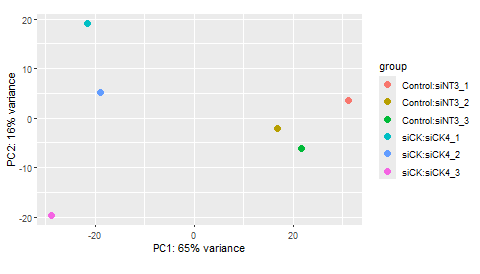

Figure 9.1: The Heatmap.

---

## 10. Optional images

In section [7. Volcano Plot Visualisation](#7-volcano-plot-visualisation) you created a volcano plot with some data point labeled and the different class of sequences coloured red, blue, green and grey. The code fragment will draw the same volcano plot without any data point labels. All the data points are black except those with a significant p-value and change in expression that are red (Figure 10.1).

> png("VolcanoPlot_no_labels.png")  

> EnhancedVolcano(res,  
    lab = c(''),  
	title = "Volcano plot",  
	subtitle = "DeSeq2 Differential expression",  
    caption = bquote(\~Log[2]\~ "fold change cutoff: 2,   
    padj -value cutoff: 0.05"),  
	pCutoff = 0.05,  
    FCcutoff = 1,  
    x = 'log2FoldChange',  
    y = 'padj',  
	col=c('black', 'black', 'black', 'red3'),  
    colAlpha = 1)  

> dev.off()

The code is the  same except for three parameters:  
> lab = c('')  

This now gives R an empty list of names for the labels and so no label text appears.  

> col=c('black', 'black', 'black', 'red3')  
colAlpha = 1

These two lines are new, with the first setting the colours for each class of data point. These colours are set as names and can be set as any colour that R recognises such as 'green', but will fail on a name like 'a pale greeny-blue'.  
The _colAlpha = 1_ set the transparency of the data point with 1 drawing solid datapoints and 0.0 a transparent disc with 0.5 been the middle point.

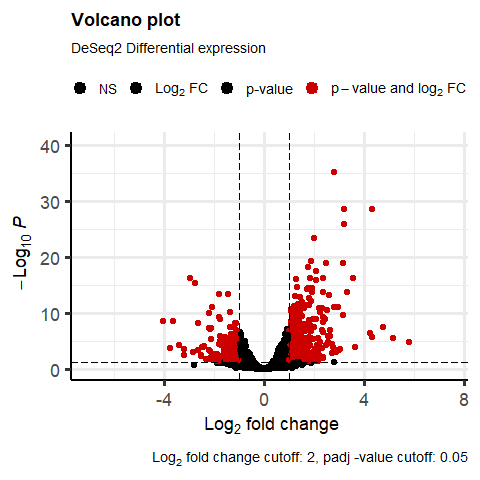

Figure 10.1: The modified volcano plot

In section [9. Principal Component Analysis (PCA) Visualisation](#9-principal-component-analysis-pca-visualisation) you draw a PCA plot where each sample had its own colour, the following code draws a PCA plot with the samples colour coded by its condition. Unlike when drawing volcano plot above, modifying the PCA plot requires a new code that uses the ggplot R package to draw the plot (Figure 10.2). Consequently, rather than getting the plotPCA function to draw the image as before, it is told to send all the raw data to a variable with this line:

>pcaData <- plotPCA(nt, intgroup=c("condition", "sample"), returnData=TRUE) 

The basic command is the same, but the  _returnData=TRUE_ parameter causes the raw data to be returned and stops the image from been drawn. In the new plot we will label the axis with the PCA1 and PCA2 percent value rather than the raw value which ranges from 0.0 to 1.0. This done with:

> percentVar <- round(100 * attr(pcaData, "percentVar"))  

The _attr(pcaData, "percentVar")_ code gets the _percentVar_ value from the variable holding the raw data (_pcaData_), which is then multiplied by 100 with the _100 *_ code. The round function then removes the decimal part of the value.

The PNG file is opened, the image is drawn and then the file saved with: 

> png("PCAPlot_plus.png")    
ggplot(pcaData, aes(PC1, PC2, color=condition)) +  
  geom_point(size=3) +  
  xlab(paste0("PC1: ",percentVar[1],"% variance")) +  
  ylab(paste0("PC2: ",percentVar[2],"% variance")) +   
  coord_fixed() +   
  ggtitle("PCA plot: condition")  
dev.off()

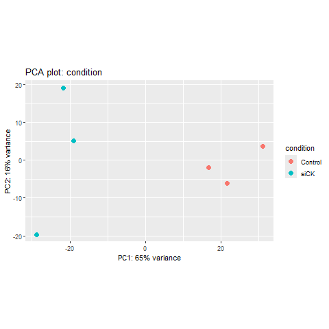

Figure 10.2: The modified PCA plot.

The code is more complex than before and is built up with a series of appended instructions (each precedes a '+'). The basic graph is drawn with: 

> ggplot(pcaData, aes(PC1, PC2, color=condition)) +

The data is in the _pcaData_ variable, with the specific values referenced with the _PC1_ and _PC2_ text and the colour coding set to the sample's condition with _color=condition_. The '+' character instructions ggplot to add the following features to the image. 

- _geom_point(size=3)_ sets the size of the data points.  
- _xlab(paste0("PC1: ",percentVar[1],"% variance"))_ sets the x-axis label (PC1: 65% variance")  
- _ylab(paste0("PC2: ",percentVar[2],"% variance"))_ sets the y-axis label (PC1: 16% variance")  
- _coord_fixed()_ ensures equal scaling on the x and y axes.
- _ggtitle("PCA plot: condition")_ sets the plot's title.

## 11. Adding gene symbols to data files

### 11.1 Using ClusterProfiler and org.Hs.eg.db

This step relies on the ClusterProfiler and org.Hs.eg.db R packages, the ClusterProfiler can be very difficult to install and so may fail completely!

Install and load the packages as before:

> if(!require("clusterProfiler")){  
  BiocManager::install("clusterProfiler")  
}  
library("clusterProfiler")  

> if (!require(org.Hs.eg.db)) {  
    BiocManager::install("org.Hs.eg.db")  
}  
library("org.Hs.eg.db")  

Next you need to make a data frame from the filtered results that you saved to file earlier:

> toName <- as.data.frame(resSig)

The GenBank/RefSeq names are used as the row names and have a version number which need to be removed with:

> rownames(toName) <- gsub("\\\\..*", "", rownames(toName))

This command, gsub looks at each row name of the toName data frame and finds the first period with "\\\\..*" and replaces all the text from the period with "" (i.e. no text).

These are then used to make fill the RefSeq column on the _toNames_ data frame with:

> toName$RefSeq <- rownames(toName)

The GenBank IDs are then used to obtain the gene symbols using the bitr function of ClusterProfiles with reference to the org.HS.eg.db which contains data on the human genome.

> sigNames <- bitr(geneID=rownames(toName), fromType = "REFSEQ", toType = "SYMBOL", OrgDb = org.Hs.eg.db)  

A new data frame is made to which the correct gene symbol has been append to with:  

> mergeSig <- merge(toName, sigNames, by.x="RefSeq", by.y="REFSEQ", all.x=TRUE, all.y=FALSE)

It is then written to file with:

> write.csv(mergeSig, file= "Results_with_names.csv")

### 11.2 Using BiomaRt

This package is easier to install than ClusterProfiler, but still may be an issue.

The package is installed and loaded like the others with:

>if(!require("biomaRt")){  
  BiocManager::install("biomaRt")  
}  
library("biomaRt")  

A connection is made to an external data source with: 

> mart <- useEnsembl("ensembl", dataset = "hsapiens_gene_ensembl", mirror = "uswest")

The connection is made to a mirror site 'uswest' rather than Ensembl since Ensembl reconfigured their webservices in a many that blockeds biomaRt. At sompoint, biomaRt will be updated and so the _mirror = "uswest"_ parameter will not be required.

As with the pervious method, you need to make a data frame from the filtered results that you saved to file earlier:

> toName <- as.data.frame(resSig)

The GenBank/RefSeq names are used as the row names and have a version number which need to be removed with:

> rownames(toName) <- gsub("\\\\..*", "", rownames(toName))

This command, gsub looks at each row name of the toName data frame and finds the first period with "\\\\..*" and replaces all the text from the period with "" (i.e. no text).

e.g. _NM_2938372.3_ becomes _NM_2938372_.

These are then used to make fill the RefSeq column on the _toNames_ data frame with:

> toName$RefSeq <- rownames(toName)

A dataset (sigNames) that links the GenBank ID's to a gene symbol is made with this command:

>sigNames <- getBM(  
  attributes = c("refseq_mrna", "hgnc_symbol"),  
  filters = "refseq_mrna",  
  values = rownames(toName),  
  mart = mart  
)  

The command uses the getBM function to return the gene annotation with the parameters described below:

|Parameter|Description|
|-|-|
|attributes = c("refseq_mrna", "hgnc_symbol")|Names the sigNames columns and defines the data it contains.|
|filters = "refseq_mrna"|Described the format of the transcript IDs used in the query|
|values = rownames(toName)|Supplies the function with the list of ID, in this case the row names of the toName data frame.|
|mart = mart|Gives the getBM the connection to the external data source|

The sigNames variable is then used to create a new column on the toName variable that contains the gene symbol for each transcript, this do with:

> mergeSig_Bio <- merge(toName, sigNames, by.x="RefSeq", by.y="refseq_mrna", all.x=TRUE, all.y=FALSE)  

And the data is written to file with: 

> write.csv(mergeSigBio, file= paste(fileBaseName,"standard_analysis_Deseq2_significant_05_names_Bio", sep="_"))
